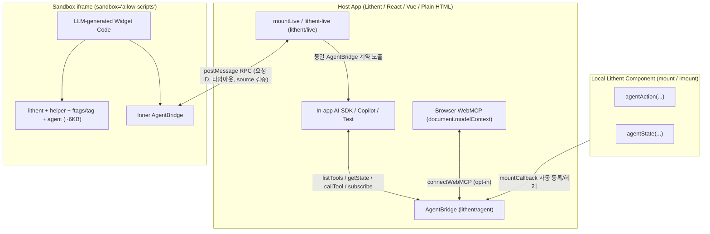

# DESIGN — `lithent/agent` & `lithent/live`

- 브랜치: `feat/agent-ui` / 기준 커밋 `ead8b2e`
- 작성일: 2026-11-27
- 상태: **설계 확정 (2026-11-27, `DC-1`~`DC-17` 확정) — Phase 1~3 (`lithent/agent`) 및 Phase 4~6 (`lithent/live` 샌드박스·RPC·Direct·`<lithent-live>`·배포 연결·문서·플레이그라운드) 구현 완료, Phase 7 하드닝·Phase 8 통합 검증(E2E `M-1`~`M-7` Chromium 자동 PASS) 완료 — 사람이 하는 수동 확인(Chrome·Safari·Firefox)과 출하 판정 대기**
- 관련 문서: [REQUIREMENTS.md](./REQUIREMENTS.md) → [IMPLEMENT.md](./IMPLEMENT.md) → [MANUAL_TEST_CHECKLIST.md](./MANUAL_TEST_CHECKLIST.md)

> **구분 표기**: `§7 결정 체크리스트(DC-1~DC-14)`는 2026-11-27 사용자 승인으로 확정되었고, 구현 중 발견된 `DC-15`·`DC-16`·`DC-17`도 같은 날 사용자 결정으로 확정되었다. 본 문서의 계약은 **확정 설계**이며, 코드 구현은 Phase 1부터 순차 진행한다. "구현 상태"·"구현 세부"·"편차 기록"·"구현 메모"·"측정 기록"·"확인 기록"으로 표시한 문단은 실제 구현된 동작을 기록한 것이다.

---

## 1. 전체 아키텍처

두 서브패스는 계층적으로 분리되며, `lithent` 코어(`src/`, `lithentConcurrent/src/`)는 수정하지 않는다 (`RQ-9`).



### 핵심 설계 원칙

1. **단일 통신 프로토콜**: 로컬 컴포넌트(`lithent/agent`)든 LLM 생성 샌드박스 위젯(`lithent/live`)이든, 소비자는 동일한 `AgentBridge` 인터페이스만 다룬다 (`RQ-4`, `RQ-8`).
2. **클로저 인스턴스 = 에이전트 엔드포인트**: `mounter`가 1회만 실행된다는 `lithent` 고유 모델 덕분에 `agentAction`·`agentState`는 `mountCallback`으로 등록/해제만 걸어주면 stale closure 없이 동작한다 (`RQ-3`).
3. **보안 기본값(Secure by Default)**: `lithent/live`는 기본값이 `mode: 'sandbox'`(격리 iframe)이며, 호스트 DOM 직결(`mode: 'direct'`)은 명시적 opt-in으로만 허용한다 (`RQ-7`).

---

## 2. `lithent/agent` 계약

### 2.1 공개 API 표면

```ts
export type ParamConstructor =
  | StringConstructor
  | NumberConstructor
  | BooleanConstructor
  | ObjectConstructor
  | ArrayConstructor;

export type ParamFieldSpec =
  | ParamConstructor
  | {
      type: ParamConstructor;
      required?: boolean;
      description?: string;
      enum?: readonly (string | number | boolean)[];
    };

export type ParamSpec = Record<string, ParamFieldSpec>;

type ConstructorToType<C> = C extends StringConstructor
  ? string
  : C extends NumberConstructor
    ? number
    : C extends BooleanConstructor
      ? boolean
      : C extends ArrayConstructor
        ? unknown[]
        : Record<string, unknown>;

type FieldToType<F> = F extends ParamConstructor
  ? ConstructorToType<F>
  : F extends { type: infer C }
    ? ConstructorToType<C>
    : unknown;

type IsRequiredField<F> = F extends { required: true } ? true : false;

export type ParamsOf<S extends ParamSpec> = {
  [K in keyof S as IsRequiredField<S[K]> extends true ? K : never]: FieldToType<S[K]>;
} & {
  [K in keyof S as IsRequiredField<S[K]> extends true ? never : K]?: FieldToType<S[K]>;
};

export type ActionConfirmContext<P = Record<string, unknown>> = {
  name: string;
  description: string;
  args: P;
};

export type ActionConfirmHandler = (
  ctx: ActionConfirmContext
) => boolean | Promise<boolean>;

export type AgentActionOptions<S extends ParamSpec | undefined, R> = {
  name: string;
  description: string;
  params?: S;
  confirm?: boolean | ActionConfirmHandler;
  bridge?: AgentBridge;
  scopeId?: string;
  run: S extends ParamSpec
    ? (args: ParamsOf<S>) => R | Promise<R>
    : () => R | Promise<R>;
};

export type AgentStateOptions = {
  bridge?: AgentBridge;
  scopeId?: string;
};

export type CreateAgentBridgeOptions = {
  onConflict?: 'warn' | 'error'; // 기본값: 'warn' (DC-3)
};

export type ToolDescriptor = {
  name: string;
  description: string;
  inputSchema: {
    type: 'object';
    properties: Record<string, Record<string, unknown>>;
    required?: string[];
  };
  requiresConfirm?: boolean;
};

export type ToolCallResult<T = unknown> =
  | { ok: true; value: T }
  | {
      ok: false;
      error: {
        code:
          | 'NOT_FOUND'
          | 'INVALID_PARAMS'
          | 'REJECTED'
          | 'EXECUTION_ERROR'
          | 'TIMEOUT';
        message: string;
        details?: unknown;
      };
    };

export type AgentBridgeEvent =
  | { type: 'tools-changed'; tools: ToolDescriptor[] }
  | { type: 'state-changed'; name?: string; state: Record<string, unknown> };

export type AgentBridge = {
  listTools: () => ToolDescriptor[];
  getState: () => Record<string, unknown>;
  callTool: (name: string, args?: Record<string, unknown>) => Promise<ToolCallResult>;
  subscribe: (listener: (event: AgentBridgeEvent) => void) => () => void;
  setConfirmHandler: (handler: ActionConfirmHandler | null) => void;
  notifyStateChange: (name?: string) => void;
  dispose: () => void;
};

// Phase 2 구현 계약 (§2.6 편차 기록 참고)
export type WebMCPTool = {
  name: string;
  description: string;
  inputSchema: ToolDescriptor['inputSchema'];
  execute: (args: Record<string, unknown>) => Promise<ToolCallResult>;
};

export type WebMCPModelContext = {
  // 현재 초안: 등록 시 넘긴 signal이 abort되면 도구가 제거된다.
  registerTool: (tool: WebMCPTool, options?: { signal?: AbortSignal }) => unknown;
  // 이전 초안·polyfill 호환 (있을 때만 호출)
  unregisterTool?: (name: string) => void;
};

export type ConnectWebMCPOptions = { target?: WebMCPModelContext };

export function createAgentBridge(options?: CreateAgentBridgeOptions): AgentBridge;
export const defaultAgentBridge: AgentBridge;

// 컴포넌트 트리 스코프 주입 (mount / lmount 공용)
export const AgentScope: ReturnType<
  typeof import('lithent').mount<{ bridge: AgentBridge }>
>;
export function useAgentBridge(): AgentBridge;

// params 미지정 시 0인자 호출, 지정 시 ParamsOf<S> 호출 오버로드
export function agentAction<R>(
  options: AgentActionOptions<undefined, R>
): () => R | Promise<R>;
export function agentAction<S extends ParamSpec, R>(
  options: AgentActionOptions<S, R> & { params: S }
): (args: ParamsOf<S>) => R | Promise<R>;

export function agentState<T>(
  name: string,
  getter: () => T,
  options?: AgentStateOptions
): void;

export function connectWebMCP(
  bridge?: AgentBridge,
  options?: ConnectWebMCPOptions
): () => void;
```

> **구현 상태 (Phase 2 완료 시점, 2026-11-27)**: 위 API 표면 전체가 `agent/src/`에 구현되었다. Phase 1: `createAgentBridge`, `defaultAgentBridge`, `agentAction`, `agentState`, `AgentScope`, `useAgentBridge`. Phase 2: `AgentBridge.setConfirmHandler`, `AgentActionOptions.confirm`, `ToolDescriptor.requiresConfirm`(confirm 선언 액션에만 `true`, 나머지는 키 없음), `connectWebMCP`. 구현하면서 추가된 공개 타입: `ParamIssue`(`INVALID_PARAMS` 상세, §2.5), `ToolDescriptor.inputSchema.additionalProperties?: false`(`DC-11` 힌트), `WebMCPTool`, `ConnectWebMCPOptions`. `WebMCPModelContext`는 원래 설계(`registerTool` + 필수 `unregisterTool`)에서 바뀌었다 (§2.6 편차 기록).

### 2.2 컴포넌트 내부 사용 예

```tsx
import { lmount } from 'lithent';
import { lstate } from 'lithent/helper';
import { agentAction, agentState } from 'lithent/agent';

const OrderList = lmount(() => {
  const status = lstate<'all' | 'delayed' | 'done'>('all');
  const minPrice = lstate(0);

  const applyFilter = agentAction({
    name: 'filter_orders',
    description: '주문 목록을 배송 상태와 최소 금액으로 필터링한다',
    params: {
      status: { type: String, enum: ['all', 'delayed', 'done'], required: true },
      minPrice: { type: Number, description: '최소 금액 (원)' },
    },
    run: ({ status: nextStatus, minPrice: nextMin = 0 }) => {
      status.value = nextStatus as 'all' | 'delayed' | 'done';
      minPrice.value = nextMin;
      return { status: status.value, minPrice: minPrice.value };
    },
  });

  agentState('order_filter', () => ({
    status: status.value,
    minPrice: minPrice.value,
  }));

  return () => (
    <button onClick={() => applyFilter({ status: 'delayed', minPrice: 0 })}>
      배송 지연만 보기
    </button>
  );
});
```

### 2.3 생명주기 연결 및 상태 변경 자동 감지 (`RQ-2`, `RQ-3`)

1. **호출 위치 검증 (`mounter` 전용)**:
   - `agentAction(...)` / `agentState(...)` 호출 시 `getComponentKey()`와 `getComponentSubInfo(compKey, 'vd')`를 확인한다 (`lithent` 공개 export).
   - `compKey === null`이거나 `vd.value !== null`(초기 렌더 이후 `updater` 내부 호출)이면 `console.warn`을 1회 출력하고 중복 등록을 방지한다.
2. **마운트/언마운트 자동 등록·해제**:
   - 내부적으로 `mountCallback(() => { ... return () => { ... }; })`를 등록한다.
   - 마운트 완료 시점에 대상 `AgentBridge`를 결정(§2.4)해 등록하고 `tools-changed` / `state-changed` 이벤트를 발행한다.
   - 언마운트 시 해당 엔트리를 제거하고 변경 이벤트를 발행한다.
3. **일반 UI 입력을 포함한 상태 변경 자동 감지 (`agentState`)**:
   - 사용자가 `agentAction`이 아닌 일반 `<input>` / `<button>`으로 컴포넌트 상태를 바꿔도 구독자가 변화를 감지할 수 있도록, `agentState`는 `updateCallback(() => () => { ... })`를 함께 등록한다 (`src/hook/updateCallback.ts`의 기본 빈 의존성 배열은 매 업데이트 완료 후 반환 콜백을 실행함).
   - 업데이트 완료 시 `getter()` 결과를 직렬화(JSON)해 직전 스냅샷과 다를 때만 마이크로태스크로 디바운스된 `bridge.notifyStateChange(fullName)`를 발행한다.
4. **사람 직접 호출 vs AI 호출 (`DC-5` 확정)**:
   - 사람이 UI에서 `applyFilter(args)`를 직접 호출할 때는 `confirm` 확인 훅을 거치지 않고 `run(args)`를 즉시 실행하며, `notifyStateChange`를 마이크로태스크로 1회 디바운스 발행한다.
   - AI가 `bridge.callTool(name, args)`로 호출할 때만 파라미터 검증과 `confirm` 승인 훅을 거친다.
   - **`confirm` 구현 세부 (Phase 2에서 확정된 동작)**:
     - 순서: `NOT_FOUND` → 파라미터 검증(`INVALID_PARAMS`, 승인을 묻지 않음) → 승인 → 실행.
     - `confirm: true`는 해당 액션이 등록된 브릿지의 `setConfirmHandler` 핸들러를 쓰고, 함수를 주면 그 함수가 브릿지 핸들러 대신 결정한다.
     - 핸들러는 `{ name(scopeId 접두사 포함 등록 이름), description, args(검증·strip된 인자) }`를 받고, 동기·비동기 모두 가능하다. 정확히 `true`일 때만 승인한다.
     - **보안 기본값**: 핸들러가 없거나, `false`·`true` 외 값을 반환하거나, 예외·거부(reject)되면 모두 `REJECTED`이며 `run`은 실행되지 않는다. 핸들러 예외 메시지는 `REJECTED`의 `message`로 전달한다.
     - 승인을 기다리는 동안 액션이 언마운트되거나 같은 이름이 다른 인스턴스로 바뀌면 실행하지 않고 `NOT_FOUND`를 반환한다.
     - `setConfirmHandler(null)`로 핸들러를 해제한다. `useAgentBridge()`의 위임 브릿지로도 설정할 수 있으나, 다른 메서드처럼 컴포넌트가 그려진 이후에 호출해야 스코프 브릿지에 적용된다 (§2.4).
5. `mount` 모드(`renew()` 수동 호출)와 `lmount` 모드(`lstate` 자동 갱신) 모두 `mountCallback`/`updateCallback`/`getComponentKey`를 동일하게 지원하므로 두 모드에서 동작 차이가 없다.
6. **구현 세부 (Phase 1에서 확정된 동작)**:
   - 변경 감지는 브릿지 단위로 모은다. `agentState`의 `updateCallback`, 사람 직접 호출, `callTool` 완료가 모두 같은 마이크로태스크 검사 1회를 예약하고, 검사는 각 상태의 직렬화 문자열을 직전 통지값과 비교한다. 바뀐 상태가 있으면 `state-changed`를 **1회** 발행하며, 바뀐 상태가 하나면 `name`에 그 이름을, 여럿이면 `name: undefined`를 담는다. 따라서 액션이 상태를 바꾼 뒤 뒤따르는 재렌더가 같은 이벤트를 다시 보내지 않는다. 사람 직접 호출도 `callTool`처럼 `run`이 예외를 던져도 검사를 예약한다 (예외 전에 바뀐 상태를 놓치지 않음 — Phase 3 리뷰 반영).
   - 상태 등록·해제 시에는 해당 `name`으로 즉시 `state-changed`를 발행한다. `notifyStateChange(name?)`는 비교 없이 즉시 발행하고 직전 통지값을 갱신한다.
   - 호출 위치 검사: 현재 컴포넌트 엔트리가 존재하고 아직 그려지지 않았을 때(`vd.value === null`)만 `mounter`로 본다. 이미 사라진 컴포넌트의 키가 남아 있는 경우(컴포넌트 밖 호출)도 엔트리가 없으므로 밖으로 판정한다. 경고는 이름별 1회다. 한계: 첫 렌더의 `updater`는 `vd.value`가 설정되기 전에 실행되므로 그 1회 호출은 등록되고, 두 번째 렌더부터 경고와 함께 무시된다 (중복 등록은 발생하지 않음).
   - 구독자(listener)가 예외를 던져도 다른 구독자와 등록 흐름은 계속되며, 예외는 `console.error`로 보고한다.

### 2.4 스코프 주입 및 중복 이름 처리 (`RQ-3`, `RQ-4`, `DC-3` 확정)

- **브릿지 결정 우선순위**:
  1. `options.bridge`가 명시적으로 전달된 경우 해당 브릿지 사용
  2. 가장 가까운 상위 `<AgentScope bridge={...}>` 컴포넌트의 브릿지 사용
  3. 둘 다 없으면 `defaultAgentBridge` 사용
- **`AgentScope` 탐색 메커니즘 (코어 무수정, `mount`/`lmount` 공용)**:
  - `<AgentScope bridge={bridge}>`는 `mount`로 구현되며, 내부 `props`에 모듈 전용 `Symbol` 키로 `bridge`를 저장하고 `children`을 그대로 `Fragment`로 반환한다 (`helper/src/hook/context.tsx`의 `Provider` 패턴과 동일).
  - 하위 컴포넌트에서 `agentAction`·`agentState`·`useAgentBridge`는 `mounter` 시점에 `compKey = getComponentKey()`를 캡처한 뒤, `mountCallback` 시점(WDom 트리 연결 완료)에 `getComponentSubInfo(compKey, 'vd')?.value`에서 `getParent()` 체인을 따라 올라가며 해당 `Symbol` 키가 붙은 조상 WDom의 `bridge`를 찾는다.
  - 이 방식은 `lithent/helper` 의존성 없이 `mount`와 `lmount` 모두에서, base·concurrent 양쪽 코어에서 동일하게 동작한다.
  - **구현 세부 (Phase 1)**: 브릿지는 각 컴포넌트가 마운트될 때 한 번 결정된다. 이후 `<AgentScope>`의 `bridge` prop을 바꿔도 이미 마운트된 컴포넌트의 등록은 옮겨지지 않는다. `useAgentBridge()`는 위임(delegating) 브릿지를 반환한다. 스코프는 컴포넌트가 그려진(`vd.value` 설정) 뒤 첫 호출에서 찾아 고정하며, 그 전에 호출된 메서드는 `defaultAgentBridge`로 간다 (`mountCallback`·이벤트 핸들러에서 사용 권장). 마운트 콜백은 자식부터 실행되므로(`src/render.ts`의 `addMountedQueue`가 자식 처리 뒤에 호출됨), 처음 구현처럼 자기 `mountCallback`에서 스코프를 정하면 이 브릿지를 자식 컴포넌트나 Custom Element에 prop으로 넘겼을 때 자식이 먼저 `defaultAgentBridge`에 등록되는 문제가 있었다 — Phase 3 리뷰 반영으로 첫 호출 시점 결정으로 바꿨다. 이 위임 브릿지는 `options.bridge`로 넘기거나 자식에게 넘겨도 동작한다.
  - 등록은 `createAgentBridge()`로 만든 브릿지(모듈 전용 `Symbol` 레지스트리 보유)에만 가능하다. 직접 만든 객체를 `options.bridge`로 넘기면 경고 1회 후 등록하지 않는다 (액션 함수 자체는 계속 동작).
  - `dispose()`는 도구·상태를 비우고, 도구가 있었다면 `tools-changed`(`tools: []`)를 발행한 뒤 구독자를 모두 해제한다. 브릿지는 이후에도 재사용할 수 있다.
- **`lithent/element` 경계 (Phase 2 확인)**: Custom Element는 내부 컴포넌트를 자체 render 루트(기본 Shadow Root)에 그리므로 WDom 부모 체인이 요소 밖으로 이어지지 않는다. 따라서 요소 바깥의 `<AgentScope>`는 요소 내부 선언에 적용되지 않고, 내부 선언은 기본적으로 `defaultAgentBridge`에 등록된다. 페이지 브릿지를 쓰려면 `Object` prop(예: `props: { bridge: Object }`, `el.bridge = bridge`)으로 넘기고 내부에서 `<AgentScope bridge={props.bridge}>` 또는 `options.bridge`로 사용한다. 여러 인스턴스는 속성 값을 `scopeId`로 써서 이름을 나눈다 (`widget-id="left"` → `left__read_label`). 요소 이동(DC-4 of `lithent/element`)은 인스턴스를 유지하므로 등록도 유지되고, 제거 시에는 요소의 언마운트 마이크로태스크 뒤에 해제된다.
- **동일 브릿지 내 중복 이름 처리 (`DC-3` 확정)**:
  - `scopeId`가 있으면 등록 이름을 `${scopeId}__${name}`으로 자동 접두사화한다 (예: `cart__add_item`; `DC-15` — `.`은 OpenAI/Anthropic 도구 이름 규칙 `^[a-zA-Z0-9_-]+$`에서 거절되므로 `__` 사용).
  - 같은 브릿지에 동일 최종 이름이 이미 등록돼 있으면:
    - `onConflict: 'warn'`(기본값): `console.warn` 출력 후 최신 인스턴스로 덮어쓴다(이전 인스턴스가 언마운트될 때는 자기 엔트리가 여전히 현재 등록된 엔트리인 경우에만 제거해 최신 인스턴스를 지우지 않도록 보호한다).
    - `onConflict: 'error'`: 등록 시 명시적 `Error`를 던진다.

### 2.5 파라미터 스키마 변환 및 검증 (`RQ-1`)

- `lithent/element`의 `PropSpec` 철학(`String`, `Number`, `Boolean`, `Object`, `Array`)을 계승해 제로 의존성 + 초경량(번들 크기 절감)을 유지한다 (`DC-2` 확정).
- `listTools()`는 선언된 `params`를 표준 JSON Schema(`type: 'object'`, `properties`, `required`, `enum`, `description`)로 변환해 반환한다 — OpenAI, Anthropic, Gemini, MCP, WebMCP 도구 규격과 즉시 호환된다.
  - **이름 규칙 주의 (`DC-15`)**: 스코프 구분자는 `__`라서 라이브러리가 만드는 부분은 OpenAI/Anthropic 도구 이름 규칙(`^[a-zA-Z0-9_-]+$`)을 지킨다. 다만 개발자가 정하는 `name`·`scopeId`도 같은 문자만 써야 하며(벤더별 길이 제한도 확인 필요, 예: OpenAI 64자), 라이브러리는 이를 검사하지 않는다.
- `callTool(name, args)` 호출 시:
  - 등록되지 않은 이름 → `{ ok: false, error: { code: 'NOT_FOUND', ... } }`
  - `params`에 선언되지 않은 여분 키는 무시(strip)하고 선언된 키만 `run(args)`에 전달한다 (`DC-11` 확정; JSON Schema에는 `additionalProperties: false`를 힌트로 유지).
  - 필수값 누락 / 타입 불일치(`Number`는 `Number.isFinite(v)` — `NaN`·`Infinity`처럼 JSON으로 표현할 수 없는 값 거절, Phase 3 리뷰 반영으로 원래의 `!Number.isNaN(v)`에서 강화, `Array`는 `Array.isArray(v)`, `Object`는 `v !== null && typeof v === 'object' && !Array.isArray(v)`) / `enum` 위반 → `{ ok: false, error: { code: 'INVALID_PARAMS', ... } }`
  - `confirm` 거부 → `{ ok: false, error: { code: 'REJECTED', ... } }`
  - `run` 예외 → `{ ok: false, error: { code: 'EXECUTION_ERROR', ... } }` (호스트 앱 크래시 방지)
- **`INVALID_PARAMS` 상세 형식 (Phase 1 구현)**: `details`는 문제를 한 번에 모두 담은 `ParamIssue[]`(`{ param, issue: 'required' | 'type' | 'enum', expected? }`)이며, `message`는 `Invalid arguments for "<name>": status (required), minPrice (type).` 형태로 LLM이 바로 자기 수정할 수 있게 한다. 인자 자체가 객체가 아니면(`null`, 배열, 문자열) `[{ param: '', issue: 'type', expected: 'object' }]`이다. 선택 파라미터에 `null`을 보내면 생략으로 보지 않고 타입 불일치로 처리한다. 읽으면 예외가 나는 인자(예외를 던지는 getter나 `Proxy`)는 `details` 없이 그 예외 메시지로 `INVALID_PARAMS`가 된다 — `callTool`은 어떤 인자에도 던지지 않는다 (Phase 7 하드닝에서 발견해 수정, `lithent/live` 호스트 검사도 같다).

### 2.6 WebMCP 어댑터 (`RQ-5`, `DC-4` 확정)

- `connectWebMCP(bridge = defaultAgentBridge, options?)`는 `options?.target ?? (typeof navigator !== 'undefined' ? (navigator as { modelContext?: WebMCPModelContext }).modelContext : undefined)`를 확인한다.
- 대상이 없으면 예외 없이 no-op 해제 함수 `() => {}`를 반환한다 (SSR 및 미지원 브라우저 안전).
- 대상이 있으면 현재 `bridge.listTools()`를 `target.registerTool(...)`로 등록하고, `bridge.subscribe`의 `tools-changed` 이벤트를 구독해 추가된 도구는 등록, 사라진 도구는 `target.unregisterTool(name)`으로 해제한다.
- 반환된 해제 함수를 호출하면 구독을 끊고 이 어댑터가 등록한 모든 도구를 `unregisterTool`로 정리한다.

> **편차 기록 (Phase 2, 2026-11-27)**: 위 세 항목은 Phase 0 시점의 WebMCP 초안(`navigator.modelContext`, `registerTool`/`unregisterTool`)을 기준으로 했다. Phase 2 착수 시 Chrome 문서([Imperative API](https://developer.chrome.com/docs/ai/webmcp/imperative-api), [Agentic JavaScript Tools](https://developer.chrome.com/docs/modern-web-guidance/guides/webmcp/agentic-javascript-tools))를 확인한 결과, 현재 API는 `document.modelContext`를 쓰고(`navigator.modelContext`는 deprecated), `unregisterTool()` 없이 `registerTool(tool, { signal })`의 `AbortSignal`을 abort해 제거하며, `execute`는 예외를 던지기보다 구조화된 오류 값을 반환하도록 권장한다. `DC-4`(명시적 opt-in 함수)는 그대로 두고, 어댑터를 두 방식 모두에 맞게 다음처럼 구현했다 (원래 계약의 상위 호환):
> - 대상 결정: `options.target` → `document.modelContext` → `navigator.modelContext` → 없으면 no-op 해제 함수.
> - 등록: 도구마다 `AbortController`를 만들어 `registerTool({ name, description, inputSchema, execute }, { signal })`로 등록한다. `registerTool`이 Promise를 반환하면 거부(reject)를 잡아 경고한다. 동기 예외도 경고 후 나머지 도구 등록을 계속한다. 실패한 등록은 등록된 목록에서 빼므로 해제 시 `unregisterTool`을 부르지 않고, 다음 `tools-changed` 동기화 때 다시 등록을 시도한다 (Phase 3 리뷰 반영).
> - 해제: 해당 `AbortController`를 abort하고, 대상에 `unregisterTool`이 있으면 함께 호출한다. abort로 이미 지워져 `unregisterTool`이 예외를 던져도 무시하고 나머지 도구 해제를 계속한다 (Phase 3 리뷰 반영).
> - 동기화: `tools-changed`마다 이름별 디스크립터를 비교한다. 사라진 이름은 해제, 새 이름은 등록, 같은 이름이 다른 디스크립터로 바뀐 경우(`DC-3` 최신 인스턴스 덮어쓰기)는 해제 후 재등록한다.
> - `execute(args)`는 `bridge.callTool(name, args)`의 `ToolCallResult`를 그대로 반환한다. 브라우저는 인자를 검증하지 않으므로 검증은 `callTool`이 맡고, 실패도 예외가 아닌 값(`{ ok: false, error }`)으로 돌아가 에이전트가 자기 수정할 수 있다. `confirm` 승인도 `callTool` 경로이므로 WebMCP 호출에 그대로 적용된다.
> - 미반영(후속 검토): WebMCP `annotations`(`readOnlyHint`, `consequentialHint` 등)와 `requiresConfirm` 매핑, `execute`의 두 번째 인자 `{ signal }`(진행 중인 액션은 취소하지 않음).

---

## 3. `lithent/live` 계약

### 3.1 공개 API 표면

```ts
export type LiveMode = 'sandbox' | 'direct';

export type LiveError = {
  phase: 'compile' | 'mount' | 'render' | 'action' | 'timeout';
  message: string;
  stack?: string;
  hint?: string;
};

export type MountLiveOptions = {
  code: string;
  container: HTMLElement;
  mode?: LiveMode; // 기본값: 'sandbox' (DC-7)
  styles?: string[];
  props?: Record<string, unknown>;
  /**
   * Sandbox iframe 내부에 주입할 자체 포함 런타임 JS 문자열.
   * 오프라인·단일 HTML 환경에서는 `lithent/live/runtime`의 `sandboxRuntimeCode`를 전달한다.
   */
  runtimeCode?: string;
  /**
   * Sandbox iframe이 `<script src="...">`로 로드할 런타임 URL (CDN/셀프호스트 `sandboxRuntime.umd.js`).
   * `runtimeCode`가 없을 때 사용한다 (`DC-6`).
   */
  runtimeUrl?: string;
  allowNetwork?: boolean; // 기본값: false (DC-7)
  autoResize?: boolean; // 기본값: true (DC-8)
  theme?: Record<string, string>; // CSS 변수 전달 (DC-8)
  timeoutMs?: number; // 기본값: 5000
  onError?: (error: LiveError) => void;
};

export type LiveHandle = {
  bridge: AgentBridge;
  updateProps: (props: Record<string, unknown>) => Promise<void>;
  reload: (nextCode: string) => Promise<void>;
  destroy: () => void;
};

export function mountLive(options: MountLiveOptions): Promise<LiveHandle>;
```

- 선택적 Custom Element 래퍼(`<lithent-live>`)는 `lithent/element` 위에 얹어 React·Vue·HTML 페이지에서도 태그 한 줄로 Generative UI를 띄울 수 있게 한다 (Phase 5~6).
  - **편차 기록 (Phase 5)**: `<lithent-live>`는 `lithent/element` 위가 아니라 `mountLive`를 감싼 plain Custom Element로 구현했고, `defineLiveElement(name = 'lithent-live')`를 호출해야 등록된다(import만으로 등록하지 않음, Custom Elements가 없는 SSR에서는 `undefined`). 근거: `lithent/element`는 lithent 컴포넌트를 요소로 만드는 도구라 이 래퍼에 쓰면 lithent 코어를 함께 끌어오는데, `<lithent-live>`는 iframe 하나를 관리할 뿐이라 코어가 필요 없다. 그래서 React·Vue 호스트가 Sandbox 위젯만 쓸 때 lithent 코어를 싣지 않아도 된다. 위젯은 이미 iframe(Sandbox)이나 Direct 모드의 자체 Shadow Root로 격리되므로, 요소는 별도 Shadow Root 없이 자기 자신(light DOM)에 그린다(인라인 `display`가 없으면 `block`).
  - **`<lithent-live>` 계약 (Phase 5)**: 속성 `code`, `mode`, `runtime-url`, `allow-network`(불리언). 프로퍼티는 같은 값과 `props`, `styles`, `theme`, `runtimeCode`, `autoResize`, `timeoutMs`, 읽기 전용 `bridge`. 같은 task 안의 변경은 마이크로태스크 한 번에 모아 적용한다: `props`만 바뀌면 `updateProps`, `code`가 바뀌면 `reload`, 그 밖의 값이 바뀌면 다시 마운트. 이벤트(버블링·composed): `live-ready`(`detail.bridge`, 마운트·`reload` 성공마다), `live-error`(`detail`은 `LiveError`). 이동(같은 task 안에서 제거 후 삽입)은 위젯을 유지하고, 제거되면 마이크로태스크 뒤 `destroy()`한다.
  - **React 18 사용 메모 (Phase 8 E2E)**: React 18은 커스텀 요소에 속성(문자열)을 넣고, 요소는 그 변경을 마이크로태스크에서 모아 시작한다. 그래서 `props` 같은 객체 프로퍼티는 커밋과 같은 task에 실행되는 `useLayoutEffect`(또는 ref 콜백)에서 넣어야 첫 시작에 반영된다. `useEffect`는 그 뒤에 실행되어, 이미 상태를 만든 위젯에 `updateProps`만 보낸다(클로저 상태는 다시 초기화되지 않는다). `live/README.md`와 스킬에 적었다.
  - **구현 세부 (Phase 4~6 리뷰 반영)**: `defineLiveElement()` 전에 요소에 넣은 프로퍼티(`el.code = ...` 등)는 접근자를 가리는 자기 프로퍼티가 된다. `connectedCallback`에서 이를 꺼내 지우고 접근자로 다시 넣는다(`lithent/element`와 같은 처리).

> **구현 상태 (Phase 5 완료 시점, 2026-11-27)**: `live/` 패키지에 `mountLive`(Sandbox·Direct 모드)와 `LiveHandle`, `defineLiveElement`(`<lithent-live>`), 샌드박스 런타임(`live/dist/sandboxRuntime.umd.js`, 문자열 `live/dist/runtime.{mjs,cjs}`의 `sandboxRuntimeCode`)이 구현되었고, `MountLiveOptions`의 모든 옵션이 동작한다. Phase 4: Sandbox 모드·RPC. Phase 5: `mode: 'direct'`, `autoResize`·`theme`, `LiveError.hint`, `<lithent-live>`. 루트 `exports["./live"]`, `exports["./live/runtime"]` 연결은 Phase 6이다. 공개 타입에 `LiveRpcMessage`, `LithentLiveElement`이 추가됐다. 세부 동작은 §3.2 "Direct 모드 구현 (Phase 5)", §3.4 "구현 세부".

### 3.2 LLM 생성 코드 계약 (`RQ-6`, `DC-6`)

LLM이 생성하는 코드는 **빌드 없는 표준 JS**이며, 런타임이 다음 심볼을 함수 스코프로 직접 주입한다:

- Core: `mount`, `lmount`, `h`, `Fragment`, `ref`, `mountCallback`, `updateCallback`, `nextTick`
- Helper: `state`, `lstate`, `computed`, `effect`, `store`, `lstore`
- Templates: `fTags`, `fFragment`, `fMount`, `flMount` (`lithent/ftags`), `lTag` (`lithent/tag`)
- Agent: `agentAction`, `agentState` (`lithent/agent`)

코드 진입점 및 런타임 분리 규약 (`DC-6`, `DC-9`, `DC-13` 확정):
- `import` 문 없이 주입된 심볼을 사용하는 빌드 없는 JS 함수 본문(`return lmount((props) => { ... })`)으로 통일한다.
- 호스트 컨트롤러(`lithent/live`, ≤ 5,500 B brotli — `DC-17`, 원래 3,000 B)가 코어 전체(4.8KB+)를 끌어안아 비대해지지 않도록, iframe 내부용 자체 포함 런타임(`lithent` + `helper` + `ftags` + `tag` + `agent` + 부트스트랩)은 별도 서브패스 **`lithent/live/runtime`**(`sandboxRuntimeCode` 문자열 export + `live/dist/sandboxRuntime.umd.js`)로 분리한다.
  - 오프라인/단일 HTML/엄격 CSP: `import { sandboxRuntimeCode } from 'lithent/live/runtime'` → `runtimeCode`로 인라인 주입 (외부 요청 0건).
  - CDN/캐시 공유: `runtimeUrl`로 `sandboxRuntime.umd.js` URL 전달.
  - `mode: 'sandbox'`에서 `runtimeCode`와 `runtimeUrl`이 둘 다 생략되면 외부 CDN을 암묵적으로 호출하지 않고 명확한 설정 오류(`LiveError(phase: 'compile')`)를 반환한다 (`DC-13` 확정).
  - `mode: 'direct'` 사용 시: 호스트 번들의 `lithent`를 그대로 사용하므로 `sandboxRuntime`을 전혀 로드하지 않는다.
  - **Direct 모드 구현 (Phase 5)**: 샌드박스 런타임의 `boot`를 이 페이지에서 그대로 실행하고, iframe 대신 컨테이너에 붙인 `div`의 open Shadow Root에 그린다. 메시지는 `postMessage` 대신 메모리에서 비동기(`queueMicrotask`)로 오가므로, RPC·승인(`DC-14`)·`reload`·`destroy`·타임아웃 로직은 Sandbox 모드와 같은 코드다. 값은 복제하지 않고 그대로 전달된다. `styles`는 Shadow Root의 `<style>`로, `theme`은 `:host{--name:value}`로 들어간다(`autoResize`는 Sandbox 전용). 처음 사용할 때 한 번 `console.warn`으로 신뢰한 코드에만 쓰라고 알린다.
  - **Direct 모드 의존성 (Phase 5)**: `boot`와 `lithent`·`lithent/helper`·`lithent/ftags`·`lithent/tag`·`lithent/agent`는 호스트 빌드에서 모두 외부(external) 모듈이고, `boot`는 동적 `import()`로 불러온다. ESM·CJS 빌드에서는 별도 청크(`boot-*.js`·`boot-*.cjs`, 공유 `names-*` 청크)로 나뉘어 Sandbox만 쓰는 소비자 번들에 이 의존성이 실리지 않는다. UMD는 코드 분할이 없어 한 파일에 포함되며, Direct 모드를 쓰려면 페이지에 `lithent`, `lithentHelper`, `lithentFTags`, `lithentTag`, `lithentAgent` 전역이 먼저 있어야 한다.
- `handle.updateProps(nextProps)`는 `lithent/element`와 동일하게 내부 Host 래퍼 컴포넌트의 `renew()`로 props만 갱신하여 위젯 내부 클로저 상태를 보존한다. 반면 `handle.reload(nextCode)`는 기존 위젯을 완전히 정리하고 새로 마운트한다.
- `skills/lithent`에 LLM이 항상 동일한 형식으로 출력하도록 1페이지 규약을 포함한다.

### 3.3 보안 경계 및 샌드박스 정책 (`RQ-7`, `DC-7`)

| 위협 | Sandbox 모드 (`mode: 'sandbox'`, 기본값) | Direct 모드 (`mode: 'direct'`, 명시적 opt-in) |
|---|---|---|
| 호스트 DOM / 쿠키 / `localStorage` 탈취 | `iframe`에 `sandbox="allow-scripts"`만 부여(`allow-same-origin` **금지**) → opaque origin으로 호스트 저장소·DOM 접근 원천 차단 | 호스트 JS 컨텍스트 공유 — **비신뢰 LLM 코드 사용 금지** (문서·타입 주석·런타임 경고 명시) |
| CSS 오염 | iframe 자체 문서 격리 | `lithent/element` Shadow DOM 격리 |
| 무한 루프 / 응답 없음 | `callTool` / `mount` 타임아웃(`timeoutMs`) 후 `TIMEOUT` 반환 및 `destroy()`로 iframe 강제 종료 가능 | 메인 스레드 공유로 강제 중단 불가 |
| 네트워크 유출(exfiltration) | 호스트가 `srcdoc` CSP 메타 태그(`default-src 'none'; script-src 'unsafe-inline' 'unsafe-eval' <runtimeUrl-origin?>; style-src 'unsafe-inline'`)로 외부 네트워크 차단 (`allowNetwork: true`로 해제 가능, `DC-7`) | 호스트 페이지 CSP에 종속 |
| `postMessage` 스푸핑 | `event.source === iframe.contentWindow` 및 세션별 랜덤 `channelId` 검증 필수 | 해당 없음 |

- **구현 메모 (Phase 4~6 리뷰 반영) — 샌드박스 메시지는 신뢰하지 않는다**: 위젯 코드는 런타임과 같은 창에서 돌기 때문에 채널 id를 알아낼 수 있다(호스트가 보내는 `call`·`props` 메시지를 직접 받아 볼 수 있다). 따라서 채널 id는 세션을 구분하고 관계없는 메시지를 거르는 용도이지 위젯에게 숨기는 비밀이 아니며, 호스트는 채널이 맞는 메시지도 모양을 확인한다: 도구 목록은 배열이고 `name`이 문자열인 항목만, 상태는 JSON 텍스트로 저장해(객체가 아니거나 직렬화할 수 없으면 `{}`) `getState()`가 항상 새 사본을 주고, `event`는 받은 객체를 넘기지 않고 확인한 캐시로 다시 만들며(알 수 없는 종류는 무시), `error`는 `LiveError` 모양(`phase`·`message` 문자열)으로 바꾸고, `resize`는 유한한 0 이상 숫자만 받는다. 그래서 위조 메시지로 호스트의 `listTools()`·`getState()`·구독자가 예외를 내지 않는다. srcdoc 시작 스크립트는 설정을 함수 스코프에 두어 `window`에 남기지 않는다(쉬운 경로만 막는 보조 조치).
- **확인 기록 (Phase 4, Chromium)**: 생성 코드에서 `parent.document`, `top.location`, `localStorage`, `document.cookie` 접근은 모두 `SecurityError`, `location.origin`은 `"null"`이었다. 기본 CSP에서 `fetch`(no-cors 포함)·이미지 요청은 차단되고, `allowNetwork: true`에서만 요청이 나갔다. 자동화된 음성 대조 테스트는 Phase 7·8에서 만든다.
- **구현 메모 (Phase 4)**: `allowNetwork: true`는 CSP 메타 태그를 넣지 않는다(sandbox 속성은 유지). srcdoc 문서는 호스트 페이지의 CSP도 함께 받으므로(정책 상속), 호스트 CSP가 `'unsafe-eval'`·인라인 스크립트를 막으면 샌드박스 런타임이 시작하지 못한다 — 엄격한 호스트 CSP에서의 동작은 Phase 7·8에서 확인한다.
- **확인 기록 (Phase 7, Chromium, 빌드한 UMD + `runtimeUrl`)**: 위젯 코드가 시도한 결과 — `parent.document`·`top.location.href`·`localStorage`·`sessionStorage`·`document.cookie` 쓰기는 모두 `SecurityError`, `location.origin`은 `"null"`, `window.open`은 `null`(`allow-popups` 없음), 채널 없이 보낸 `postMessage`는 호스트가 무시, 호스트 쿠키는 그대로. 기본 CSP에서 `fetch`(no-cors 포함)는 `TypeError`, 이미지·`sendBeacon`은 브라우저 안에서 `csp`로 막혀 네트워크에 나가지 않았다(`sendBeacon`은 `true`를 돌려주지만 요청이 없다). `allowNetwork: true`에서는 `fetch`·`sendBeacon`·이미지 요청이 나갔고 저장소·부모 접근은 여전히 막혔다. 호스트 페이지 CSP가 `script-src 'self'`이면 샌드박스가 정책을 상속해 시작하지 못하고 `LiveError(phase: 'timeout')`으로 끝난다(시작 타임아웃 힌트가 CSP를 함께 안내). 저장소의 자동 브라우저 테스트는 Phase 8 E2E가 맡는다.

### 3.4 `postMessage` RPC 프로토콜 (`RQ-8`, `DC-8`, `DC-14`)

호스트 ↔ 샌드박스 iframe 간 메시지는 JSON 직렬화 가능한 평면 객체만 허용한다:

```ts
type LiveRpcMessage =
  | { ch: string; type: 'ready'; tools: ToolDescriptor[]; state: Record<string, unknown> }
  | { ch: string; type: 'event'; event: AgentBridgeEvent }
  | { ch: string; type: 'error'; error: LiveError }
  | { ch: string; type: 'call'; id: number; name: string; args?: Record<string, unknown> }
  | { ch: string; type: 'result'; id: number; result: ToolCallResult }
  | { ch: string; type: 'props'; id: number; props: Record<string, unknown> }
  | { ch: string; type: 'ack'; id: number }
  | { ch: string; type: 'resize'; height: number };
```

- **호스트 측 `confirm` 승인 처리 (`DC-14` 확정)**: `handle.bridge.callTool(name, args)` 호출 시 호스트 프록시 브릿지가 캐시된 `ToolDescriptor.requiresConfirm`을 먼저 확인해 호스트에 등록된 `confirmHandler`를 실행한다. 거부되면 iframe으로 `call` 메시지를 보내지 않고 즉시 `{ ok: false, error: { code: 'REJECTED', ... } }`를 반환한다.
  - **구현 세부 (Phase 4~6 리뷰 반영)**: 승인 전에 호스트가 위젯이 보고한 `inputSchema`로 인자를 `lithent/agent`와 같은 규칙(§2.5, `DC-11`)으로 검사한다(`live/src/args.ts`). 틀리면 승인을 묻지도, iframe으로 보내지도 않고 `lithent/agent`와 같은 `INVALID_PARAMS`(같은 메시지·`details`)를 돌려준다. 통과하면 `confirmHandler`와 `call` 메시지 모두 선언된 키만 남긴 인자를 받는다. 따라서 `lithent/agent`와 순서가 같다: 검사 → 승인 → 실행. 샌드박스 브릿지가 다시 검사한다. 스키마도 샌드박스에서 오므로 모양이 틀려도 예외를 내지 않는다.
  - **승인은 그 위젯에만 유효 (Phase 7 하드닝에서 발견해 수정)**: 호출이 시작될 때의 세션을 기억해, 승인을 기다리는 사이 `reload`·`destroy`로 세션이 바뀌었으면 새 위젯에 같은 이름의 도구가 있어도 보내지 않고 `NOT_FOUND`(`"…" was removed before it ran.`)를 돌려준다. `lithent/agent`가 엔트리 동일성으로 막는 것과 같은 결과다.
- **자동 높이 조절**: `autoResize: true`(기본값)일 때 iframe 내부 `ResizeObserver`가 콘텐츠 높이를 `resize` 메시지로 전달해 호스트가 iframe 높이를 자연스럽게 맞춘다.
- **오류 자기 수정(Self-Repair)**: 컴파일/마운트/렌더 오류 발생 시 `LiveError`에 `phase`, `message`, 그리고 `lithent` 흔한 실수(`mounter`가 JSX를 직접 반환함, `lstate`를 `mount`에서 사용함 등)에 대한 `hint`를 포함해 호스트 LLM 루프에 즉시 되돌릴 수 있게 한다 (`RQ-8`).
- **구현 세부 (Phase 4에서 확정된 동작)**:
  - **시작과 실패**: `mountLive`는 샌드박스가 `ready`를 보내면 `LiveHandle`로 resolve한다. 시작에 실패하면(설정 오류, `error` 메시지, `timeoutMs` 안에 `ready` 없음) iframe을 지우고 `LiveError`로 **reject**하며 `onError`도 호출한다. LLM 루프는 고친 코드로 `mountLive`를 다시 부르거나, 이미 있는 핸들에서는 `reload`를 부른다. `reload(nextCode)`는 기존 iframe을 닫고(진행 중 호출은 `NOT_FOUND`) 구독자에게 `tools-changed`(`[]`)를 알린 뒤 새 채널의 새 iframe을 열며, 실패하면 같은 방식으로 reject하고 샌드박스 없이 남는다(다음 `reload`로 복구). `destroy()` 뒤의 `reload`는 `LiveError(phase: 'mount')`로 reject한다.
  - **시작 중의 `reload`·`destroy` (Phase 4~6 리뷰 반영)**: 시작 중인(`ready` 전) 세션도 다음 `reload`·`destroy`가 닫는다. 그 `reload` Promise는 `LiveError(phase: 'mount')`로 reject하며, 호출한 쪽이 요청한 일이므로 `onError`는 부르지 않는다. 시작 타이머도 지운다. 그래서 늦게 온 `ready`가 파괴된 핸들에 iframe·리스너를 남기지 않는다.
  - **샌드박스를 만들 수 없을 때 (Phase 4~6 리뷰 반영)**: `runtimeUrl`이 URL이 아니거나 `props`를 JSON으로 만들 수 없으면(순환 참조) `LiveError(phase: 'mount', message: 'The sandbox could not be set up: ...')`로 reject하고 `onError`를 한 번 부른다. 시작 타이머를 지우므로 나중에 `timeout` 오류가 따로 오지 않는다.
  - **오류 phase 구분**: 문법 오류·최상위 예외·컴포넌트가 아닌 반환값 → `compile`, 첫 렌더(mounter 포함) 예외 → `mount`, 시작 후 샌드박스 창의 `error`·`unhandledrejection` → `render`(위젯은 유지), 응답 없음 → `timeout`. 런타임 스크립트가 로드되지 않으면(잘못된 `runtimeUrl`, 차단) srcdoc의 시작 스크립트가 즉시 `compile` 오류를 보내 타임아웃까지 기다리지 않는다.
  - **채널과 대상 origin**: 채널 id는 `crypto.getRandomValues` 기반 랜덤 문자열(비보안 origin에서도 동작)이다. 호스트 → 샌드박스는 opaque origin이라 `targetOrigin '*'`로 보내고, 샌드박스 → 호스트는 시작 설정으로 받은 호스트 origin을 대상으로 보낸다(file: 페이지처럼 origin이 `"null"`이면 `'*'`). 호스트는 `event.source === iframe.contentWindow`와 채널을, 샌드박스는 `event.source === parent`와 채널을 확인한다.
  - **응답 순서**: 샌드박스는 `call`의 `result`와 `props`의 `ack`를 대기 중인 마이크로태스크(상태 변경 알림 포함)가 모두 끝난 뒤 보낸다. 따라서 `await bridge.callTool()`·`await updateProps()` 직후의 `bridge.getState()`는 최신이다.
  - **샌드박스 안의 브릿지**: 위젯은 런타임이 만든 전용 브릿지의 `<AgentScope>` 아래에 그려진다. 호스트가 이미 승인했으므로(`DC-14`) 샌드박스 브릿지의 승인 핸들러는 항상 승인한다. 인자 검증은 샌드박스 브릿지가 하고, 결과 값을 `postMessage`로 복제할 수 없으면(함수 등) `EXECUTION_ERROR` 결과로 바꿔 보낸다.
  - **호스트 프록시 브릿지**: `listTools()`·`getState()`는 `ready`·`event`로 받은 캐시의 사본을 준다. 알 수 없는 도구는 왕복 없이 `NOT_FOUND`, 응답이 없으면 `TIMEOUT`(+ `onError` `timeout`), 인자를 복제할 수 없으면 `INVALID_PARAMS`, 형식이 틀린 결과는 `EXECUTION_ERROR`. `notifyStateChange(name?)`는 캐시된 상태로 즉시 `state-changed`를 보내고, `dispose()`는 `destroy()`와 같다.
  - **`props` 메시지**: `updateProps`는 호스트에 새 props를 기억한 뒤(이후 `reload`에도 사용) `ack`를 기다린다. 응답이 없으면 `LiveError(phase: 'timeout')`로 reject한다.
  - **새 props로 다시 그리다 예외가 날 때 (Phase 4~6 리뷰 확인)**: lithent의 `renew()`는 다시 그리기를 마이크로태스크에 넣기만 하므로(`src/utils/redraw.ts`) `renew()`도 `nextTick()`도 예외를 내지 않고, `ack`는 바로 간다. 렌더 예외는 샌드박스 창의 `error` 리스너를 거쳐 `onError`(`phase: 'render'`)로 온다. 따라서 `updateProps`는 타임아웃까지 멈추지 않고 resolve한다.
- **구현 세부 (Phase 5에서 확정된 동작)**:
  - **자기 수정 힌트**: 호스트가 오류와 그 오류를 낸 코드로 `hint`를 붙인다(이미 `hint`가 있으면 유지). 엔진마다 문구가 달라 메시지를 느슨하게 맞추고 코드도 함께 본다. 대상: JSX(`'<'` 토큰 오류) → `fTags`/`lTag` 안내, `import` 문 → 이미 주입된 심볼 안내, `export` 문 → `return` 안내, 컴포넌트 미반환 → `return lmount(...)` 예시, React 습관(`useState`·`useEffect`·`React` 등 미정의) → `lstate`/`state`·`mountCallback` 안내, `render`·`createRoot` 직접 호출 → 반환만 하라는 안내, 그 밖의 미정의 이름 → 사용 가능한 심볼 목록, `timeout` → 무한 루프·끝나지 않는 Promise 점검(시작 타임아웃이면 호스트 페이지 CSP가 인라인 스크립트와 `'unsafe-eval'`을 허용해야 한다는 안내 추가 — Phase 7). mounter가 렌더 함수 대신 마크업을 바로 반환(`lmount(() => fTags.p(...))`) → `mount` 단계 "… is not a function"이고 코드에 `=> () =>`·`return () =>` 렌더 함수가 없으면 렌더 함수를 반환하라는 안내 (Phase 8, `M-5` (3)의 예시가 힌트 없이 끝나던 것을 E2E에서 발견). 처음 예시로 든 "`lstate`를 `mount`에서 사용"은 현재 lithent에서 오류가 나지 않으므로(`lstate`는 `useRenew()`라 두 모드에서 모두 동작) 힌트 대상에서 뺐다. "`mounter`가 JSX를 직접 반환"은 빌드 없는 코드에서 JSX 문법 오류로 나타나므로 JSX 힌트가 맡는다.
  - **자동 높이 (`DC-8`)**: Sandbox에서 `autoResize`가 `false`가 아니면 런타임이 `document.documentElement`를 `ResizeObserver`로 지켜보다가 높이(올림한 정수)가 바뀔 때만 `resize`를 보내고, 호스트가 iframe `style.height`를 맞춘다. 음수·숫자 아닌 값은 무시한다. `ResizeObserver`가 없는 환경에서는 아무것도 하지 않는다.
  - **테마 (`DC-8`)**: `theme`의 `--이름: 값` 쌍만 CSS 사용자 정의 속성으로 넣는다(Sandbox는 srcdoc의 `:root{...}`, Direct는 `:host{...}`). 이름은 `^--[\w-]+$`, 값에 `;`·`{`·`}`·`<`·`>`가 있으면 버린다. 마운트·`reload` 때 적용된다.

---

## 4. 기존 `lithent` 패키지와의 통합 경계

| 기존 자산 | 통합 방식 | 코어 변경 여부 |
|---|---|---|
| `lithent` (`src/`) | `mount`, `lmount`, `mountCallback`, `updateCallback`, `getComponentKey`, `getComponentSubInfo`, `Fragment`, `render`, `h`, `nextTick`만 import | 0줄 (`RQ-9`) |
| `lithent-concurrent` | `LITHENT_CORE=concurrent` alias로 동일 코드 테스트 | 0줄 (`RQ-9`, `RQ-11`) |
| `lithent/element` | Custom Element 내부에서 `agentAction`/`agentState` 사용, `<lithent-live>` 래핑, Direct 모드 Shadow DOM | 0줄 (공개 API만 사용) |
| `lithent/ftags`, `lithent/tag` | `lithent/live` 런타임에 주입되는 빌드 없는 템플릿 계층 | 0줄 |
| `lithent/test` | 단위 테스트에서 `render`, `act`, `cleanup` 활용 | 0줄 |
| `scripts/size-report.js` | `lithent/agent`, `lithent/live`, `lithent/live/runtime` UMD 크기 예산 타깃 추가 | 배포/빌드 설정만 변경 |
| `scripts/verify-release.mjs` | 새 공개 export 경로(`./agent`, `./live`, `./live/runtime`) ESM/CJS/타입 검증 추가 | 배포/빌드 설정만 변경 |
| `skills/lithent`, `lithent-agent-addon.md` | `lithent/agent`, `lithent/live` 사용 규칙 및 LLM 생성 코드 규약 추가 | 문서/스킬 업데이트 |

---

## 5. 번들 크기 및 빌드 구성

기존 `element/`, `test/` 위성 패키지 패턴을 그대로 따른다:

- 워크스페이스 패키지 및 산출물:
  - `agent/` (패키지명 `lithent-agent`, UMD 전역 `lithentAgent`): `agent/dist/lithentAgent.{mjs,cjs,umd.js}`, `index.d.{ts,cts}`
  - `live/` (패키지명 `lithent-live`, UMD 전역 `lithentLive`): `live/dist/lithentLive.{mjs,cjs,umd.js}`, `index.d.{ts,cts}` + 별도 샌드박스 번들 `live/dist/sandboxRuntime.umd.js` 및 문자열 export `live/dist/runtime.{mjs,cjs}` (`lithent/live/runtime`)
- 외부 의존성: **0개** (런타임 zero-dependency)
- 크기 예산(`DC-9` 확정):
  - `agent/dist/lithentAgent.umd.js`: ≤ **2,500 B** brotli (`DC-16`으로 2,000 B에서 상향; `connectWebMCP`는 같은 엔트리, ESM 소비자는 tree-shaking)
  - `live/dist/lithentLive.umd.js` (호스트 컨트롤러): ≤ **5,500 B** brotli (`DC-17`으로 3,000 B에서 상향; Direct 모드·`<lithent-live>` 포함, ESM 소비자는 tree-shaking·지연 청크)
  - `live/dist/sandboxRuntime.umd.js` (iframe 자체 포함 런타임: core + helper + ftags + tag + agent + bootstrap): ≤ **11,000 B** brotli
  - 코어 `dist/lithent.umd.js`: ≤ 4,800 B (무변화)

---

## 6. 실패 모드 및 오류 처리 정책

| 실패 시나리오 | 동작 | 검증 |
|---|---|---|
| `agentAction`을 `mounter` 밖(`updater` 등)에서 호출 | `getComponentKey()`/`vd.value` 검사로 감지해 1회 경고 출력 및 중복 등록 방지 (`DC-3`) | Phase 1, Phase 7 |
| `agentState` getter가 예외를 던지거나 순환 참조 반환 | 해당 키를 `{ __agentStateError: message }`로 격리하고 `console.warn` 1회 출력, 나머지 키는 정상 반환 (`DC-12`) | Phase 1, Phase 7 |
| 언마운트 직후 진행 중이던 `callTool` 완료 | 브릿지 이벤트 누수 없이 결과 반환 또는 정리, 이후 호출은 `NOT_FOUND` | Phase 1, Phase 7 |
| `lithent/live` Sandbox 모드에서 `runtimeCode`·`runtimeUrl` 모두 미지정 | 숨겨진 외부 CDN 호출 없이 `LiveError(phase: 'compile')` 반환 (`DC-13`) | Phase 4, Phase 7 |
| `lithent/live`에 문법 오류/런타임 예외 코드 전달 | 호스트 페이지 무영향, `onError` + `LiveError(phase, message, hint)` 반환 | Phase 4, Phase 7 |
| Sandbox iframe이 무한 루프/무응답 | `timeoutMs` 만료 시 `TIMEOUT` 오류 반환, `destroy()`로 iframe 제거 | Phase 4, Phase 7 |
| 악성 LLM 코드가 `window.parent` / `document.cookie` 접근 시도 | 브라우저 opaque-origin `SecurityError` 차단, 호스트 데이터 유출 0건 | Phase 4, Phase 8, `M-4` |

---

## 7. 결정 체크리스트 (`DC-*`)

> **확정 이력 (2026-11-27)**: 사용자가 `DC-1`~`DC-14` 전 항목을 권장안으로 확정함.

- [x] **DC-1 — 배포 위치 및 서브패스 이름**
  - **확정**: 옵션 A — `lithent` 패키지 내 서브패스 `lithent/agent`, `lithent/live` (및 인라인 샌드박스 번들용 `lithent/live/runtime`)로 제공.
  - **근거**: `lithent/element`, `lithent/test`와 동일한 위성 패키지·서브패스 관례를 따라 설치 장벽과 버전 불일치 리스크를 없앤다.
  - 검증: Phase 3, Phase 6 (`verify-release.mjs`)

- [x] **DC-2 — `agentAction` 파라미터 스키마 형식**
  - **확정**: 옵션 A — `lithent/element`와 일관된 경량 생성자 스펙(`String`, `Number`, `Boolean`, `Object`, `Array` 및 `{ type, required, description, enum }`) → JSON Schema 자동 변환.
  - **근거**: 외부 스키마 라이브러리 없이 제로 의존성·2KB 이내 크기를 지키면서도 LLM/MCP 표준 JSON Schema를 출력할 수 있다.
  - 검증: Phase 1, Phase 7

- [x] **DC-3 — 다중 인스턴스 이름 충돌 & 브릿지 스코프 주입 방식**
  - **확정**: 옵션 A — `scopeId`가 있으면 `${scopeId}__${name}` 자동 접두사(원래 `.` 구분자 → 2026-11-27 `DC-15` 결정으로 `__`), 미스코프 충돌은 `console.warn` + 최신 인스턴스 등록(`onConflict: 'error' | 'warn'` 옵션 제공). 서브트리 주입은 `<AgentScope bridge={...}>` + `useAgentBridge()` 제공(WDom 부모 체인 탐색, `mount`/`lmount` 공용).
  - **근거**: 프로덕션에서 동적 리스트/위젯 중복 마운트로 인한 예기치 않은 크래시를 막으면서 개발 시 충돌을 즉시 인지할 수 있고, `lithent/helper` 없이 양쪽 모드에서 동작한다.
  - 검증: Phase 1, Phase 7

- [x] **DC-4 — WebMCP 어댑터 범위 및 기본 동작**
  - **확정**: 옵션 A — 명시적 opt-in `connectWebMCP(bridge, options?)` 함수로 제공.
  - **근거**: 라이브러리 import만으로 전역 `navigator.modelContext`를 암묵적으로 변경하는 부작용을 방지하고, 브라우저 표준 변화에 안전하게 격리한다.
  - **구현 메모 (Phase 2)**: 결정은 그대로이며, 감지 대상과 해제 방식만 현재 WebMCP에 맞게 넓혔다 (`document.modelContext` 우선, `AbortSignal` 해제 + `unregisterTool` 호환 — §2.6 편차 기록).
  - 검증: Phase 2, `M-2`

- [x] **DC-5 — `confirm` 승인 훅 동작 범위**
  - **확정**: 옵션 A — `bridge.callTool()`(AI 호출 경로)에서만 `confirm` 핸들러를 실행하고, 사람이 UI 버튼 `onClick`으로 직접 호출할 때는 즉시 실행.
  - **근거**: 사람이 직접 누른 UI 조작에 이중 확인이 뜨는 불편을 없애고, AI의 자율 호출에 대해서만 승인 안전장치를 제공한다.
  - 검증: Phase 1, Phase 2, `M-5`

- [x] **DC-6 — `lithent/live` 생성 코드 규약 및 샌드박스 런타임 주입 방식**
  - **확정**: 코드 규약 옵션 A(`import` 없이 주입된 `lithent`/`helper`/`ftags`/`tag`/`agent` 심볼을 사용하는 빌드 없는 JS 함수 본문) + 샌드박스 번들 로드 옵션 1(오프라인 인라인 주입용 `lithent/live/runtime`의 `sandboxRuntimeCode`를 `runtimeCode`로 전달, CDN/로컬 UMD는 `runtimeUrl`로 오버라이드).
  - **근거**: 호스트 컨트롤러(`lithent/live`)를 3KB 이내로 유지하면서도 오프라인·단일 HTML·엄격한 CSP 환경에서 외부 요청 없이 동작하며, LLM이 import 경로 실수 없이 높은 원샷 정확도로 코드를 생성할 수 있다.
  - 검증: Phase 4, Phase 5, `M-3`

- [x] **DC-7 — `lithent/live` 샌드박스 CSP 및 네트워크 정책**
  - **확정**: 옵션 A — `iframe`에 `sandbox="allow-scripts"` 강제(`allow-same-origin` 금지) + 기본 CSP 메타 태그로 외부 `fetch`/`img`/`script` 차단(`allowNetwork: true`로 명시적 해제 가능).
  - **근거**: 비신뢰 LLM 생성 코드로부터 호스트 DOM·저장소 탈취와 무단 네트워크 유출을 기본값으로 차단한다.
  - 검증: Phase 4, Phase 7, Phase 8, `M-4`

- [x] **DC-8 — `lithent/live` iframe 크기 조절 및 테마 전달**
  - **확정**: 옵션 A — `ResizeObserver` 기반 자동 높이 동기화 기본 활성화(`autoResize: true`) + 호스트 CSS 변수/테마 토큰 전달 옵션(`theme?: Record<string, string>`).
  - **근거**: 채팅/사이드바 내 임베드 위젯의 이중 스크롤바 문제를 없애고 호스트 다크모드·브랜드 색상과 자연스럽게 어우러지게 한다.
  - **구현 메모 (Phase 5)**: `ResizeObserver` → `resize` 메시지 → iframe 높이, `theme` → CSS 사용자 정의 속성으로 구현했다 (§3.4 구현 세부 Phase 5). Chromium에서 120px → 260px 높이 변경과 테마 색 적용을 확인했다.
  - 검증: Phase 5, `M-3`, `M-6`

- [x] **DC-9 — 번들 크기 예산**
  - **확정**: `lithent/agent` ≤ **2,500 B** brotli (원래 2,000 B → 2026-11-27 `DC-16` 결정으로 상향), `lithent/live` (호스트 컨트롤러) ≤ **5,500 B** brotli (원래 3,000 B → 2026-11-27 `DC-17` 결정으로 상향), `lithent/live/runtime` (`sandboxRuntime.umd.js`) ≤ **11,000 B** brotli (`scripts/size-report.js` 게이트 등재, 코어 4,800 B 무변화).
  - **근거**: 호스트 앱에 추가되는 오버헤드와 샌드박스 자체 포함 런타임 예산을 분리해 `lithent`의 초경량 정체성을 CI 게이트로 강제한다.
  - **측정 기록**: Phase 1 종료 1,884 B → Phase 2 종료 **2,340 B** (원래 예산 2,000 B 초과 → `DC-16`으로 예산 2,500 B 확정, 여유 160 B) → Phase 3 리뷰 반영 후 **2,374 B** (여유 126 B) → Phase 7 하드닝 후 **2,387 B** (여유 113 B, 읽으면 예외가 나는 인자 처리 +13 B).
  - **측정 기록 (`lithent/live`)**: Phase 4 종료 호스트 2,084 B · 런타임 8,277 B → Phase 5 종료 호스트 **4,536 B**(원래 예산 3,000 B 초과 → `DC-17`으로 예산 5,500 B 확정, 여유 964 B) · 런타임 8,485 B → Phase 4~6 리뷰 반영 후 호스트 **5,082 B**(여유 418 B, 호스트 인자 검사·메시지 확인·시작 중단 처리 +546 B) · 런타임 8,485 B(변화 없음) → Phase 7 하드닝 후 호스트 **5,145 B**(여유 355 B, 승인 세션 확인·인자 읽기 예외 처리·CSP 힌트 +63 B) · 런타임 8,478 B → Phase 8 후 호스트 **5,207 B**(여유 293 B, mounter 실수 힌트 +62 B) · 런타임 8,478 B.
  - 검증: Phase 3, Phase 6 (`pnpm size`)

- [x] **DC-10 — 릴리스 순서 (단계적 출하 여부)**
  - **확정**: 옵션 A — Phase 1~3 완료 시 `lithent/agent` 단독 1차 minor 릴리스 → Phase 4~8 완료 시 `lithent/live` 및 양방향 데모를 2차 minor 릴리스.
  - **근거**: `lithent/agent`를 먼저 시장에 내보내 빠른 피드백을 얻고, 보안 샌드박스가 포함된 `lithent/live`의 검증 리스크를 분리한다.
  - 검증: Phase 3, Phase 8, `M-1`~`M-7`

- [x] **DC-11 — `agentAction` 미선언 여분 파라미터 키 처리**
  - **확정**: 선언되지 않은 여분 키는 무시(strip)하고 `params`에 선언된 키만 `run(args)`에 전달한다(JSON Schema에는 `additionalProperties: false`를 힌트로 유지).
  - **근거**: LLM이 부가 메타 키를 실수로 포함해 보내더라도 불필요한 도구 호출 실패를 줄이고 `run()`에는 검증된 입력만 전달한다.
  - 검증: Phase 1, Phase 7

- [x] **DC-12 — `agentState` getter 예외 및 직렬화 불가 값 처리**
  - **확정**: 해당 키의 값을 `{ __agentStateError: message }`로 격리해 반환하고 `console.warn`을 1회 출력한다(나머지 상태 키는 정상 반환; `BigInt`는 문자열화, 함수/`undefined`는 JSON 직렬화 규칙으로 안전 변환).
  - **근거**: 한 컴포넌트의 상태 오류가 전체 화면 스냅샷 조회를 마비시키지 않으면서도 디버깅·AI가 오류 원인을 즉시 식별할 수 있다.
  - 검증: Phase 1, Phase 7

- [x] **DC-13 — `lithent/live` Sandbox 모드에서 `runtimeCode`·`runtimeUrl` 모두 생략 시 동작**
  - **확정**: `runtimeCode`(`lithent/live/runtime`) 또는 `runtimeUrl` 중 하나를 필수로 요구하고, 둘 다 없으면 외부 CDN을 암묵적으로 호출하지 않고 명확한 설정 오류(`LiveError(phase: 'compile')`)를 반환한다.
  - **근거**: 기업망·오프라인·엄격한 CSP 환경에서 예기치 않은 외부 CDN 요청이 발생하지 않도록 보장한다.
  - 검증: Phase 4, Phase 7

- [x] **DC-14 — `lithent/live` Sandbox 위젯의 `confirm` 승인 훅 실행 위치**
  - **확정**: 호스트 측 프록시 `bridge`가 `requiresConfirm`을 확인해 호스트의 `confirmHandler`로 먼저 승인받은 뒤에만 iframe으로 `postMessage('call')`을 전달한다.
  - **근거**: 호스트 앱이 일관된 자체 승인 모달/오버레이 UI를 띄울 수 있고, 거부된 호출은 샌드박스 내부에 아예 도달하지 않는다.
  - 검증: Phase 4, Phase 7, `M-5`

- [x] **DC-15 — `scopeId` 구분자와 LLM 도구 이름 규칙 호환성 (Phase 1 구현 중 발견)**
  - **문제**: `DC-3`의 원래 형식 `${scopeId}.${name}`은 MCP 도구 이름에는 허용되지만, OpenAI·Anthropic 도구 이름 규칙(`^[a-zA-Z0-9_-]+$`)은 `.`을 거절하므로 `listTools()` 결과를 그대로 넘길 수 없었다. §2.5의 "OpenAI, Anthropic, Gemini, MCP, WebMCP 도구 규격과 즉시 호환" 서술과 충돌했다.
  - **옵션**: A) `.` 유지, 소비자가 이름을 변환 / B) 구분자를 `_` 또는 `__`로 변경 / C) `createAgentBridge({ separator })` 옵션 제공.
  - **확정 (2026-11-27 사용자 결정)**: 옵션 B — 구분자를 **`__`(더블 언더스코어)**로 변경한다. 등록 이름은 `${scopeId}__${name}` (예: `cart__add_item`).
  - **근거**: `.`은 OpenAI/Anthropic 도구 이름 규칙(`^[a-zA-Z0-9_-]+$`)에서 거절된다. `__`는 그 규칙 안에 있으면서, 단일 `_`를 쓰는 일반 이름(`add_item`)과 스코프 경계를 구분해 준다.
  - **구현**: `agent/src/hooks.tsx`의 `fullName` 한 곳 (`DC-3`, §2.4 반영). 이름 규칙을 만족하려면 `scopeId`와 `name` 자체도 `[a-zA-Z0-9_-]`만 써야 한다 (라이브러리는 검사하지 않음 — §2.5 주의).
  - 검증: `agent/src/tests/lifecycle.test.tsx`(`cart__add_item` 및 `^[a-zA-Z0-9_-]+$` 검사), `agent/src/tests/element-interop.test.tsx`(`left__read_label`), Phase 7 이름 규칙 테스트.

- [x] **DC-16 — `lithent/agent` UMD 크기 예산 초과 대응 (Phase 2 구현 후 발견)**
  - **문제**: Phase 2 종료 시 `agent/dist/lithentAgent.umd.js`가 brotli **2,340 B**로 `DC-9`의 원래 예산(2,000 B)을 340 B 초과했다. 증가분은 `confirm` 승인 훅 약 165 B, `connectWebMCP` 약 290 B (Phase 1 종료 1,884 B 기준). `connectWebMCP`를 빼고 측정해도 2,049 B였다.
  - **옵션**:
    - A) `lithent/agent` 예산을 상향 (현재 구조 유지).
    - B) `connectWebMCP`를 별도 서브패스(예: `lithent/agent/webmcp`)로 분리하고 코어 예산을 소폭 상향.
    - C) 기능·메시지를 줄여 2,000 B 유지 (오류 메시지·경고 품질 저하 위험).
  - **확정 (2026-11-27 사용자 결정)**: 옵션 A — `lithent/agent` 예산을 **2,500 B** brotli로 상향한다 (제안안 2,400 B에 Phase 7 하드닝 여유분 추가). `connectWebMCP`는 분리하지 않고 같은 엔트리에 두며, 쓰지 않는 소비자에게서는 번들러 tree-shaking으로 빠지게 한다.
  - **근거**: 구조를 단순하게 유지하고(서브패스 추가 없음), Phase 7 하드닝으로 늘어날 코드까지 예산 안에서 수용한다. WebMCP를 쓰지 않는 앱은 tree-shaking으로 비용을 내지 않는다.
  - **확인 기록**: 결정 반영 후 UMD 2,340 B / 2,500 B (여유 160 B). tree-shaking: `agent/dist/lithentAgent.mjs`를 esbuild로 번들(`lithent` external, minify)하면 `connectWebMCP`를 import하지 않는 소비자 번들은 brotli 1,879 B이고 `modelContext`·`AbortController` 코드가 포함되지 않는다. import하면 2,174 B다. (`sideEffects: false`인 루트 패키지 서브패스로 배포)
  - 검증: Phase 3 (`scripts/size-report.js`에 2,500 B로 등재, `pnpm size`).

- [x] **DC-17 — `lithent/live` 호스트 UMD 크기 예산 초과 대응 (Phase 5 구현 후 발견)**
  - **문제**: Phase 5 종료 시 `live/dist/lithentLive.umd.js`가 brotli **4,536 B**로 `DC-9`의 원래 예산(3,000 B)을 1,536 B 초과했다. UMD는 코드 분할이 없어 Direct 모드의 `boot`까지 한 파일에 들어간다. esbuild로 기능별 기여를 따로 재면(빌드 도구 차이로 절대값은 vite보다 조금 크다): 기본(Sandbox + 테마·리사이즈) 약 2,800 B, Direct 모드 약 +710~840 B, 자기 수정 힌트 약 +500~660 B, `<lithent-live>` 약 +650 B. 어느 하나만 빼서는 3,000 B 안에 들어오지 않았다.
  - **옵션**:
    - A) `lithent/live` 호스트 예산을 상향 (현재 구조 유지).
    - B) Direct 모드와 `<lithent-live>`를 별도 서브패스(예: `lithent/live/direct`, `lithent/live/element`)로 분리하고 `lithent/live`는 Sandbox 호스트만 담는다 (`mode: 'direct'`·`defineLiveElement` 위치가 바뀜).
    - C) 기능·문구를 줄여 3,000 B에 가깝게 (힌트 문구 축약 등으로는 수백 B 수준이라 단독으로는 부족).
    - D) 예산 측정 대상을 UMD 대신 ESM 기본 청크(minify)로 바꾼다.
  - **확정 (2026-11-27 사용자 결정)**: 옵션 A — `lithent/live` 호스트 예산을 **5,500 B** brotli로 상향한다 (5,000 B안은 현재 합계에 거의 붙어 있어 Phase 7 하드닝 여유분 추가). `DC-16`과 같은 원칙으로 API는 분리하지 않고 구조를 유지하며, 측정 기준도 UMD brotli(`scripts/size-report.js`)를 유지한다.
  - **근거**: `mode: 'direct'`와 `defineLiveElement`를 `lithent/live` 한 엔트리에 두는 단순한 API를 지키고, CDN 사용자가 받는 UMD를 그대로 게이트로 삼는다. Sandbox만 쓰는 ESM 소비자는 아래처럼 tree-shaking·지연 청크로 비용을 덜 낸다.
  - **확인 기록 (ESM tree-shaking, 참고)**: `live/dist/lithentLive.mjs`를 esbuild로 번들(`lithent`·하위 경로 external, minify, splitting)하면 `defineLiveElement`를 import하지 않는 소비자의 초기 청크는 brotli **3,093 B**이고 `<lithent-live>` 코드(`live-ready`, `customElements.define`)가 포함되지 않는다. import하면 3,741 B(+648 B). 두 경우 모두 Direct 모드 청크(878 B + 147 B)는 `mode: 'direct'`를 쓸 때만 지연 로드된다. 결정 시점 UMD는 4,536 / 5,500 B (여유 964 B).
  - 검증: Phase 6 (`scripts/size-report.js`에 5,500 B로 등재, `pnpm size`).
